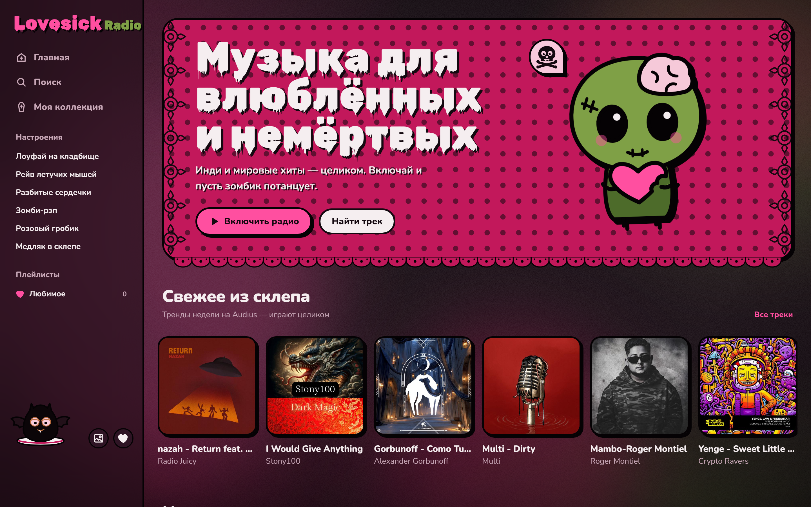
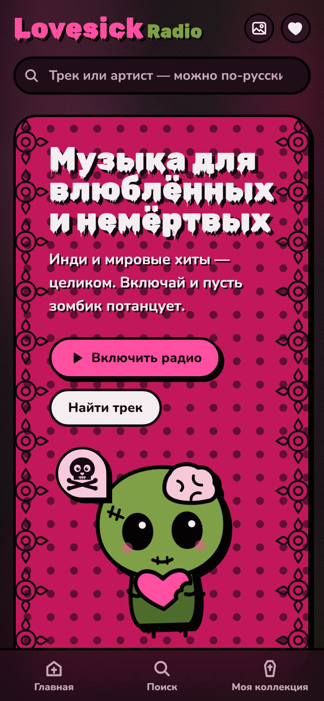

# Lovesick Radio 🦇

**Music streaming website in a "cute halloween" style** — pink polka dots, black lace, zombie green.
Full-length indie tracks, world charts, moods, playlists and an animated mascot that dances to the music.

**🔗 Live demo: [lovesick-radio.vercel.app](https://lovesick-radio.vercel.app)**



<p align="center"></p>

## Features

- **Three music sources in one player** — Audius (full indie tracks), Deezer (world charts and search),
  YouTube (full versions of chart hits through the official embedded player)
- **Player** — queue, shuffle, repeat, real-time audio analysis that drives the animations
- **Library** — likes and playlists with generated covers
- **Smart search** — understands Cyrillic spelling of artist names («дрейк» → Drake)
- **Moods** — genre collections with halloween names
- **Hand-drawn SVG mascots** and layered animated backgrounds (fog, lace, velvet, moon)
- **Responsive** — works on desktop and phones

## Tech stack

Next.js 16 (App Router, `"use cache"`) · React 19 · TypeScript · Tailwind CSS 4 · Zustand · Playwright · Vercel

## Engineering

- **Rate limiting** per IP for search and track lookup (`src/proxy.ts`)
- **Security headers** — CSP, frame protection (`next.config.ts`)
- **Smoke tests** in a real browser run automatically on GitHub after every Vercel deploy
- **Health monitoring** — `/api/health` checks Audius, Deezer and YouTube Music every 6 hours via GitHub Actions
  and sends an email if something is down

## Run locally

```bash
npm install
npm run dev                       # http://localhost:3000
npm run build && npx next start   # production build
npm run test:smoke                # browser smoke test
```

Optional: `YOUTUBE_API_KEY` in `.env.local` enables full-length versions of chart hits
(without it they play as 30-second previews).

## Project structure

| Path | What's inside |
|---|---|
| `src/app/globals.css` | the whole design: palette, fonts, polka dots, lace |
| `src/components/Mascots.tsx` | SVG mascots |
| `src/store/player.ts` | player: queue, shuffle, repeat, audio analysis |
| `src/store/library.ts` | likes and playlists |
| `src/lib/audius.ts`, `deezer.ts`, `youtube.ts` | music sources |
| `src/lib/ytEngine.ts`, `src/components/YouTubeDock.tsx` | second player engine (YouTube) |
| `src/lib/translit.ts` | Cyrillic → Latin search |

---

Made by **[Kyryl](https://github.com/kyrylo157)** — available for freelance projects.
