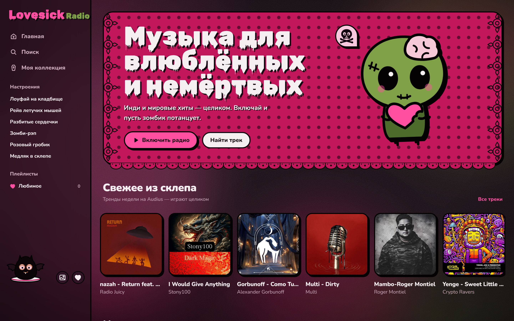
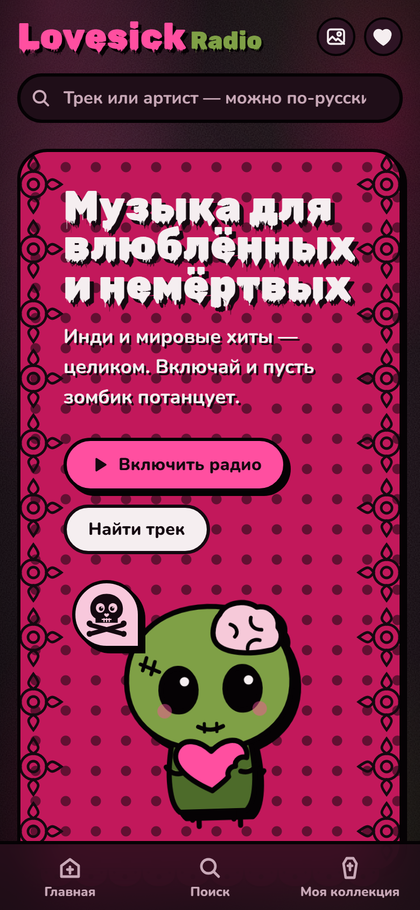

# Lovesick Radio 🦇

**Music streaming website in a "cute halloween" style** — pink polka dots, black lace, zombie green.
Full-length indie tracks, world charts, moods, playlists and an animated mascot that dances to the music.

**🔗 Live demo: [lovesick-radio.vercel.app](https://lovesick-radio.vercel.app)**

## Features

- **Three music sources in one player** — Audius (full indie tracks), Deezer (world charts and search),
  YouTube (full versions of chart hits through the official embedded player)
- **Player** — queue, shuffle, repeat, real-time audio analysis that drives the animations
- **Library** — likes and playlists with generated covers
- **Smart search** — understands Cyrillic spelling of artist names («дрейк» → Drake)
- **Moods** — genre collections with halloween names
- **Hand-drawn SVG mascots** and layered animated backgrounds (fog, lace, velvet, moon)
- **Responsive** — works on desktop and phones

## Tech stack

Next.js 16 (App Router) · React 19 · TypeScript · Tailwind CSS 4 · Zustand · Playwright · Vercel

## Engineering

- **Rate limiting** per IP for search and track lookup
- **Security headers** — CSP, frame protection
- **Smoke tests** in a real browser run automatically after every deploy
- **Health monitoring** — the three music sources are checked every 6 hours,
  with an email if something is down

---

> Source code is private. Want a site like this for your business? Message me.

Made by **[Kyryl](https://github.com/kyrylo157)** — available for freelance projects.
